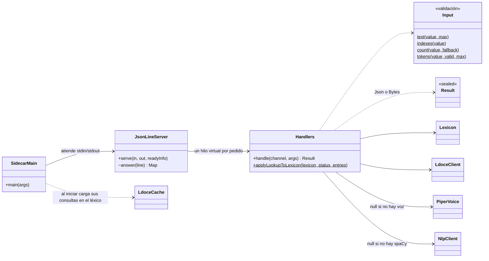
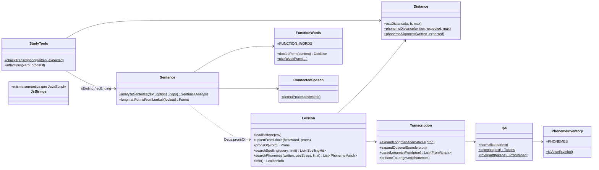
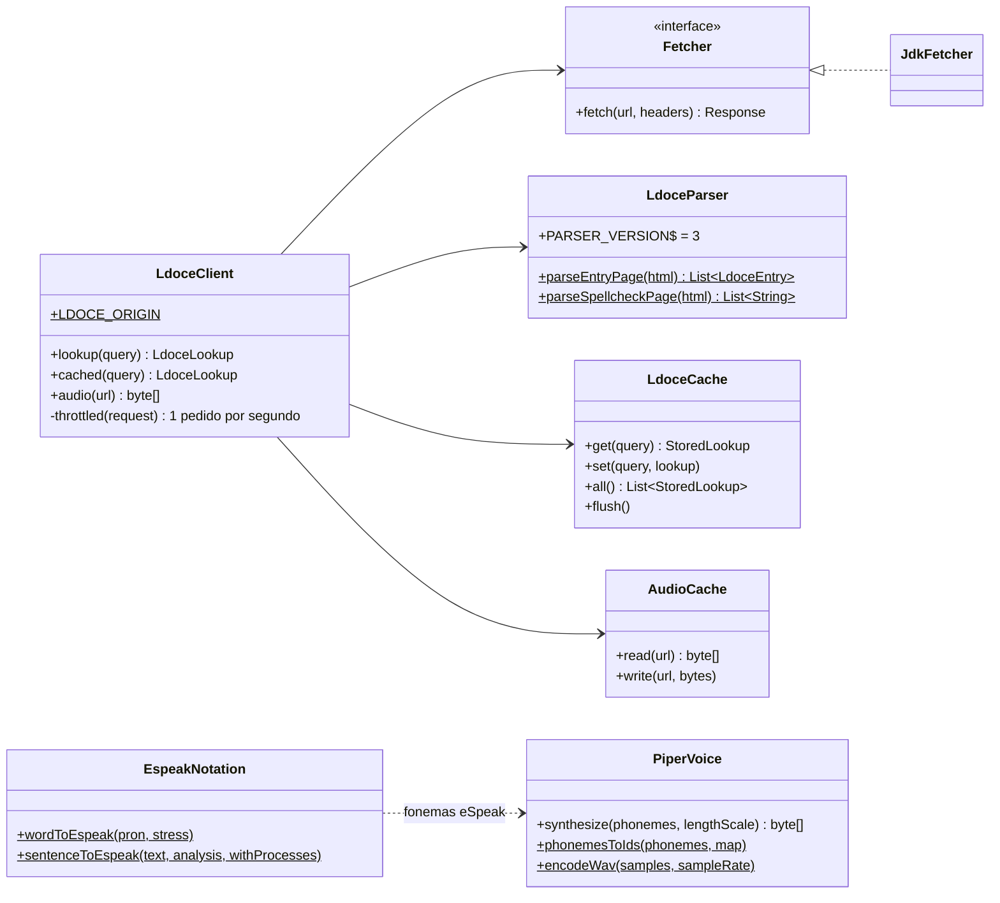
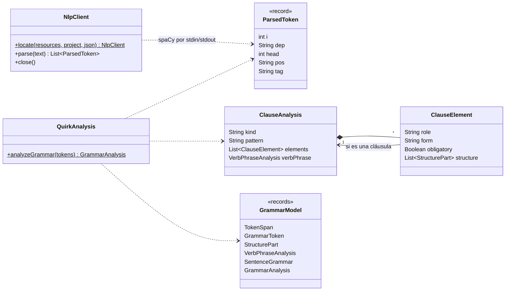

# Clases del motor Java (sidecar-java/)

Paquete raíz `com.dmc00.fonetica`. Un diagrama por paquete; los records del contrato JSON (`api/`) no se
dibujan: tienen las mismas formas que `shared/fonetica-api.ts`.

## Arranque y protocolo

## core

## ldoce y tts

## grammar

