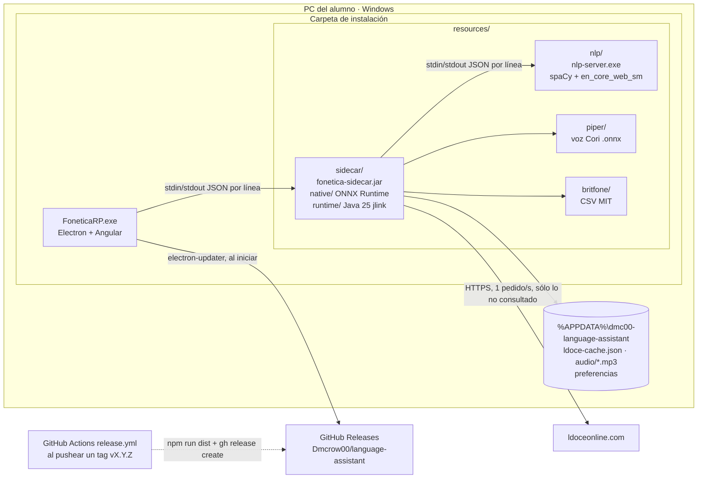

# Despliegue

Todo corre en la PC del alumno. Lo único externo es Longman (sólo para palabras que no se consultaron
antes) y GitHub Releases (para buscar actualizaciones).

| Pieza | Origen | Cómo llega |
|---|---|---|
| `FoneticaRP-Setup-x.y.z.exe` | `npm run dist` (electron-builder, NSIS), en `release.yml` | GitHub Releases (o copia directa) |
| `resources/sidecar` | `npm run build:sidecar` (Maven + jlink) | dentro del instalador |
| `resources/nlp` | `npm run build:nlp` (PyInstaller) | dentro del instalador |
| `resources/piper` | `npm run fetch-voice` (Hugging Face, con MD5) | dentro del instalador |
| Caché y preferencias | la app, con el uso | `%APPDATA%`, nunca junto al ejecutable |
