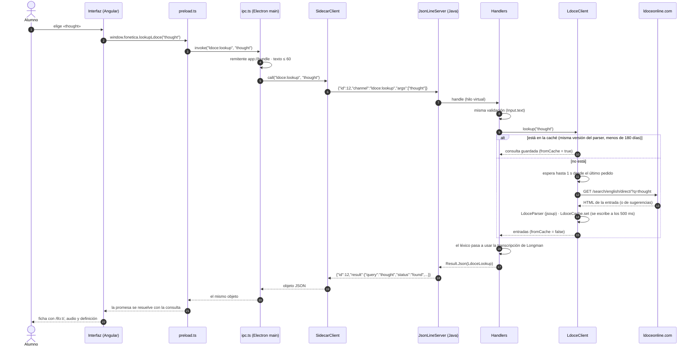
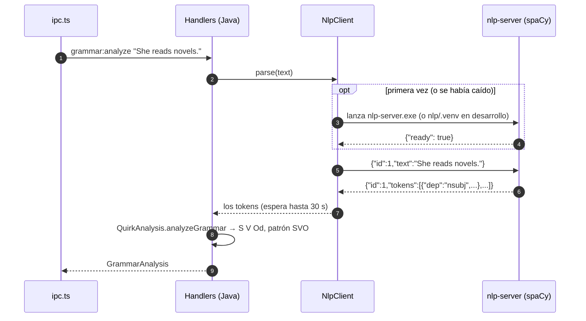
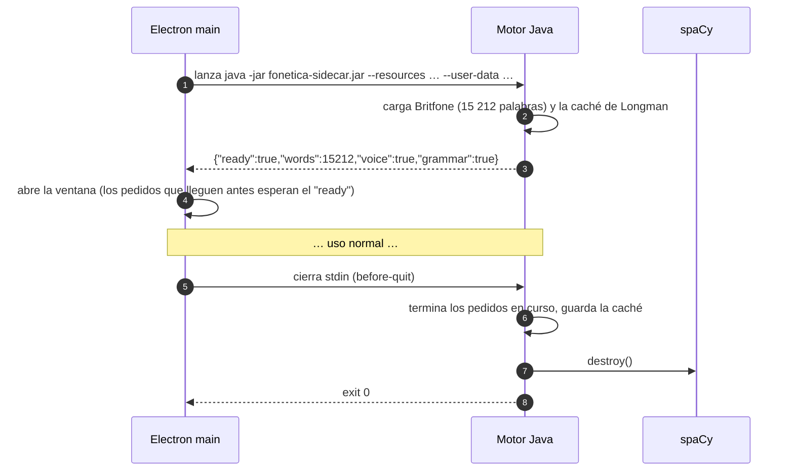
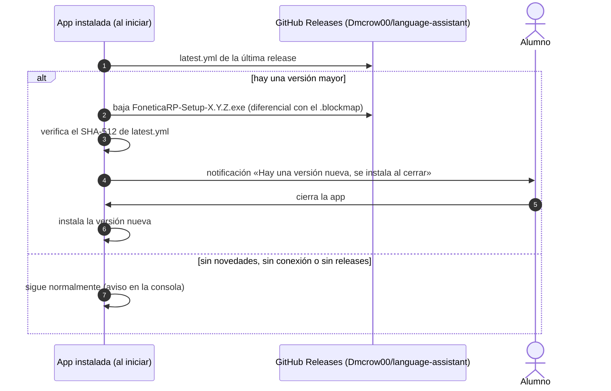

# Secuencias

## Una consulta IPC: buscar una palabra en Longman

El alumno elige "thought" en Buscar palabra. Es el camino de cualquier canal del motor; los otros sólo
cambian lo que pasa dentro de `Handlers`.

Si el motor responde `{"id":12,"error":"..."}`, `SidecarClient` rechaza la promesa con ese mensaje y la
interfaz lo recibe igual que antes (`Error invoking remote method 'ldoce:lookup': Error: ...`). Si no
responde en 60 s, o el proceso se cae, la promesa se rechaza y el próximo pedido relanza el motor.

## Análisis gramatical (motor → spaCy)

## Arranque y cierre

## Actualización automática

